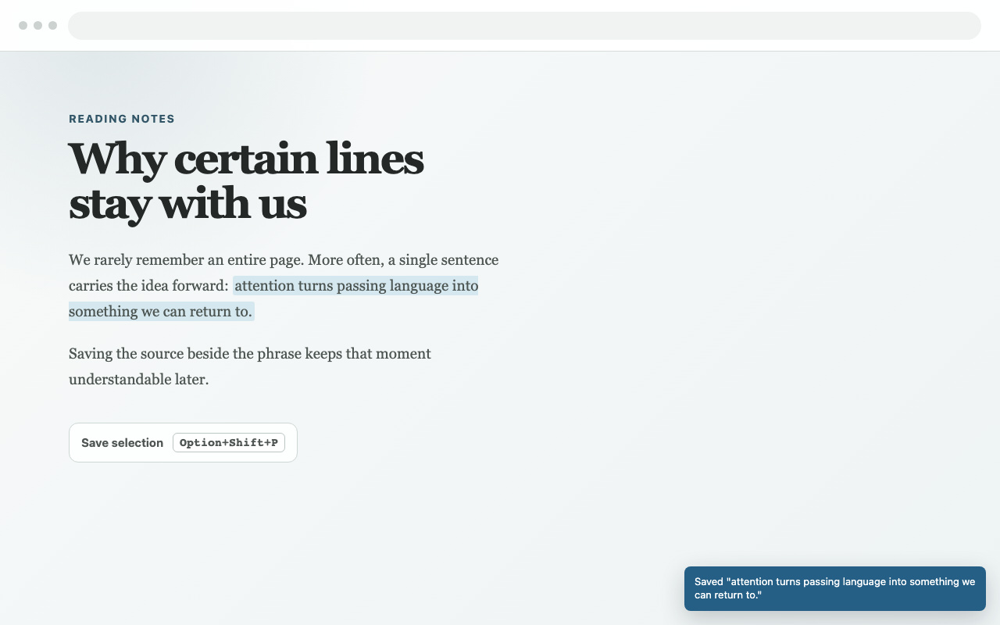

# Phraselet for Chrome

Phraselet is a local-first Chrome extension for saving words and phrases as you encounter them online. It captures the selected text, source URL, page title, and surrounding context. Windows and Linux are supported too.

## Install the extension

1. In Chrome, visit `chrome://extensions`.
2. Enable **Developer mode**.
3. Choose **Load unpacked**.
4. Select this repository folder.

## Using Phraselet

1. Highlight a word or phrase on a regular webpage.
2. Press `Alt+Shift+P` (`Option+Shift+P` on macOS) or right-click and choose **Save to Phraselet**. You can change the shortcut in Phraselet's **Settings → Change shortcut**.
3. Open the extension popup to review your saved cards.

Selections over 500 characters are shortened at the nearest word boundary before they're saved.

Cards are stored in `chrome.storage.local` on your machine. Phraselet accesses page content only when you invoke a save action. It doesn't install a persistent script on every site.

## Feature set

Phraselet's feature set includes:

- Context-menu capture for highlighted text
- Source title, URL, and nearby context capture
- Duplicate-aware capture and import
- Local card library with editable notes, tags, filtering, and related phrases
- A Current default view plus **Archived** and **All cards** views
- Single-card and bulk archive and restore controls
- Bulk selection for tagging, archiving, export, copy, and deletion
- Tag autocomplete, rename, and delete controls
- Restorable, versioned JSON backups plus export-only Markdown and CSV formats
- Copy or export only the phrases selected in bulk mode
- A quiet backup reminder when a library of at least 10 phrases goes 30 days without a complete JSON backup. **Later** snoozes it for seven days
- Configurable confirmation or popup after saving
- First-install welcome guide with capture and data-handling details
- Gesture-scoped page access, bounded capture and import data, and restricted extension storage
- No backend service required

### Importing and exporting

JSON is Phraselet's lossless backup format. Phraselet accepts compatible schema versions 1–3. You can also export your library as Markdown or CSV, but can't import them back into Phraselet.

JSON imports accept files up to 32 MiB to accommodate formatted backups. The merged library still follows the 5,000-phrase and 8 MiB safeguards. Importing merges into the latest library and doesn't reset the complete-backup reminder. Captures, edits, tags, imports, archive changes, and deletions share a background write queue so that overlapping operations don't overwrite unrelated changes.

## Packaging

Run `npm run package` to create the local-first Chrome Web Store ZIP in `dist/`. The package contains no AI provider code, API-key controls, third-party host access, or standing clipboard permission.

## Development checks

Run `npm run check` to syntax-check the extension scripts and execute the automated tests. The same command runs in GitHub Actions.

## Project documents

- [RELEASE.md](RELEASE.md): Tracks the Chrome Web Store submission checklist and manual testing still required.
- [STORE_LISTING.md](STORE_LISTING.md): Contains the prepared listing copy and permission disclosures.
- [PRIVACY.md](PRIVACY.md): The policy for the public base build.

The [Phraselet website](https://phraselet-cards.dreamingbigdreams.chatgpt.site) hosts the public [privacy policy](https://phraselet-cards.dreamingbigdreams.chatgpt.site/privacy/) and [support page](https://phraselet-cards.dreamingbigdreams.chatgpt.site/support/).

## License

Phraselet is available under the [MIT License](LICENSE).
